# Templates and InstanceTypes

OpenShift Virtualization provides **Templates** and **InstanceTypes** to simplify and standardize the deployment of virtual machines.

Although both help create consistent VM configurations, they serve different purposes:

- **Templates** provide a predefined VM configuration and can include the operating system, disks, networking, CPU, memory, and other VM properties.
- **InstanceTypes** provide standardized compute configurations, primarily CPU and memory, which can be combined with an operating system image and other VM-specific settings.

A simple way to remember the difference is:

> **Template = What should this VM look like?**  
> **InstanceType = How much compute should this VM have?**

In this tutorial, you will:

- Explore the predefined VM templates.
- Create a custom template based on a Red Hat-provided template.
- Customize the new template.
- Create a VM from the customized template.
- Explore predefined InstanceTypes.
- Create a VM using an InstanceType.
- Compare Templates and InstanceTypes.

---

## Prepare for the lab

1. The tasks in this lab require several additional VMs. Before starting, shut down the existing VMs to ensure that sufficient resources are available in the shared environment.

1. Navigate to Virtualization persona in the left-side menu and then click on **VirtualMachines**.

1. The project assigned to VM-"your-name"-1, that is hosting VM workloads, will be listed in the center column tree view.

1. If any VMs are showing a status of Running, highlight the VM in the center tree column, and select the Stop button or option from the Actions dropdown menu.

Now all VMs should be in Stopped state.

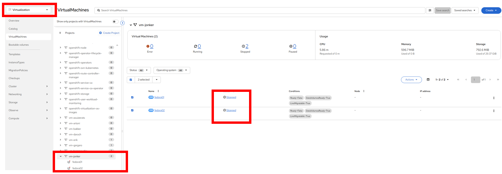

---

## Clone and Customize a Template

OpenShift Virtualization provides predefined VM templates for commonly used operating systems. These templates provide standardized starting configurations for creating virtual machines.

Templates provided by Red Hat are managed by the OpenShift Virtualization Operator and cannot be edited directly. To customize a Red Hat-provided template, first create a custom template based on it. OpenShift creates the custom template by cloning the selected template into your own project. The original Red Hat template remains unchanged.

### Clone a Red Hat template

1. Go to **Virtualization → Templates** and set the project dropdown to **openshift**.
2. In the filter field, select **Name** and enter:   `centos9`
3. Find the template to start from, for example `centos-stream9-server-small`

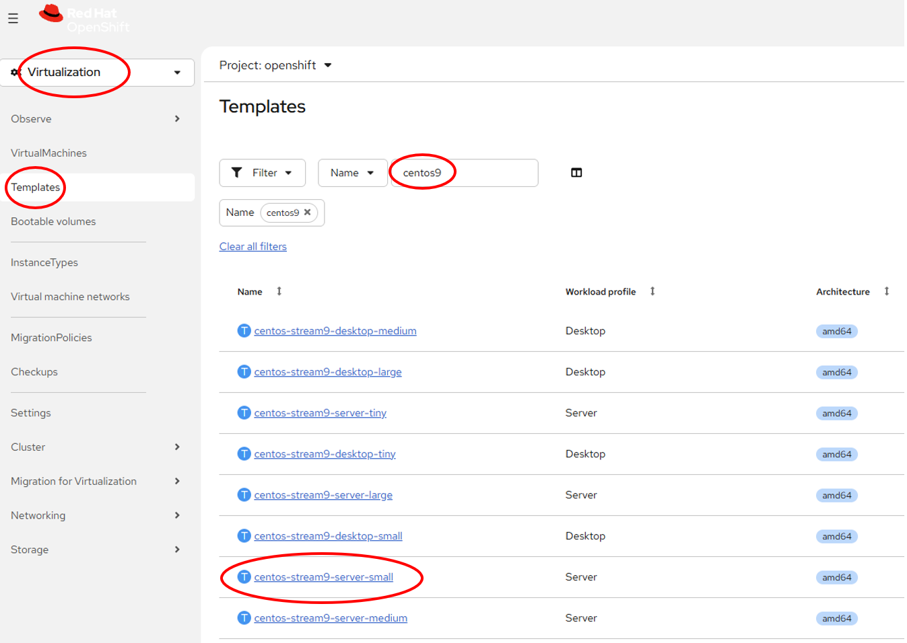

4. Open the **⋮** menu on its row and choose **Clone**.
5. Fill in the dialog:
   - **Template project:** `openshift`
   - **Display name:** something users will recognize, for example `Centos VM <your name>`
   - **Provider:** your team or company name
   - **Clone boot source:** leave unchecked, so the template keeps using the shared, auto-updated boot source
6. Click **Clone**.
7. The **Clone template** window opens.
8. Enter the following information:

  **Template name**

  `centos-stream9-server-small-<your name>`

  **Template project**

  Select your own project, for example:

  `VM-<your name>-1`

  Do not select the `openshift` project.

  **Template display name**

  `CentOS Stream 9 Database Server <your name>`

  **Template provider**

  `ROVS Tutorial`

9. Click **Clone**.

> **Note:** OpenShift creates the custom template by cloning the selected Red Hat template into your project

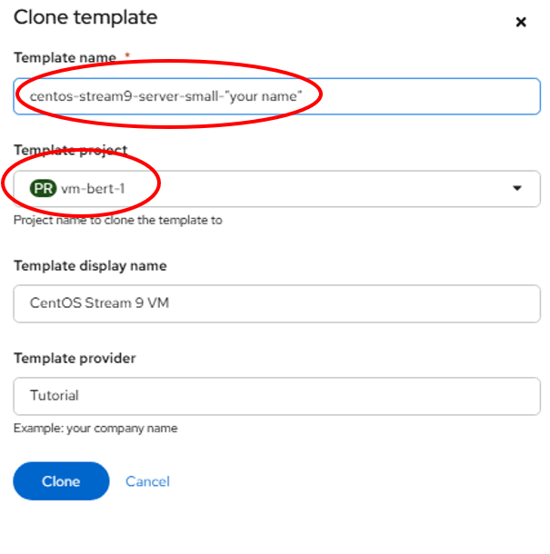

### Alternative method to Clone a Red Hat template

1. Go to **Virtualization → Templates** and set the project dropdown to **openshift**.
2. In the filter field, select **Name** and enter:   `centos9`
3. Find the template to start from, for example `centos-stream9-server-small`
4. Click the template name:

  `centos-stream9-server-small`

5. Review the template details.

An information message at the top of the page explains that templates provided by Red Hat are not editable. The page provides a **Create a new custom Template** option for creating an editable template based on the selected Red Hat template.
6. Click **Create a new custom Template**.

7. The **Clone template** window opens.
8. Enter the following information:

  **Template name**

  `centos-stream9-server-small-<your name>`

  **Template project**

  Select your own project, for example:

  `VM-<your name>-1`

  Do not select the `openshift` project.

  **Template display name**

  `CentOS Stream 9 Database Server "your name"`

  **Template provider**

  `ROVS Tutorial`

9. Click **Clone**.

> **Note:** Although the action on the template details page is called **Create a new custom Template**, OpenShift creates the custom template by cloning the selected Red Hat template into your project. The disabled **Clone** action in the Templates list does not prevent this workflow.


### Open the custom template

1. Go to **Virtualization → Templates** and set the project dropdown to: `VM-<your name>-1`
2. Find the template you just created `CentOS Stream 9 Database Server "your name"`
3. Click the template name to open it.
4. Verify that the custom template is in your project and that the provider is shown as **ROVS Tutorial**.

The custom template can now be modified without changing the original Red Hat-provided template.

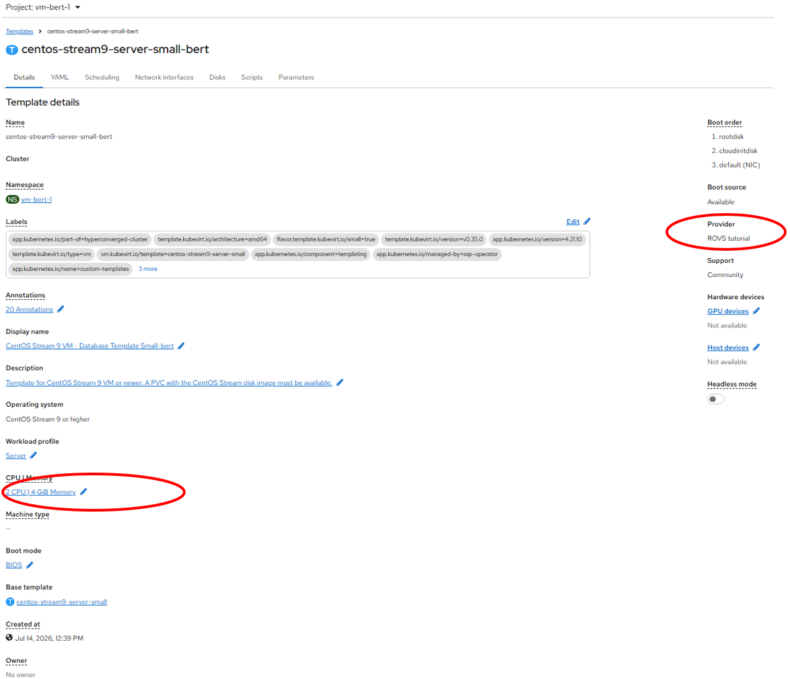

### Customize the template

1. Review the available configuration tabs and settings for the custom template. Depending on the template and your permissions, these can include:

- CPU and memory
- Disks
- Network interfaces
- Boot configuration
- Scheduling
- Scripts
- Parameters
- Labels and annotations

2. For this tutorial, configure the custom template with:

- **CPU:** 2 vCPUs
- **Memory:** 4 GiB

3. Save the changes.


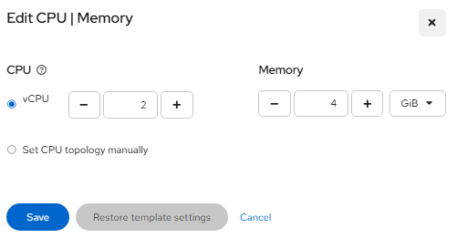

4. Next, click on the Scripts tab at the top, and in the section called Cloud-init click the Edit button.

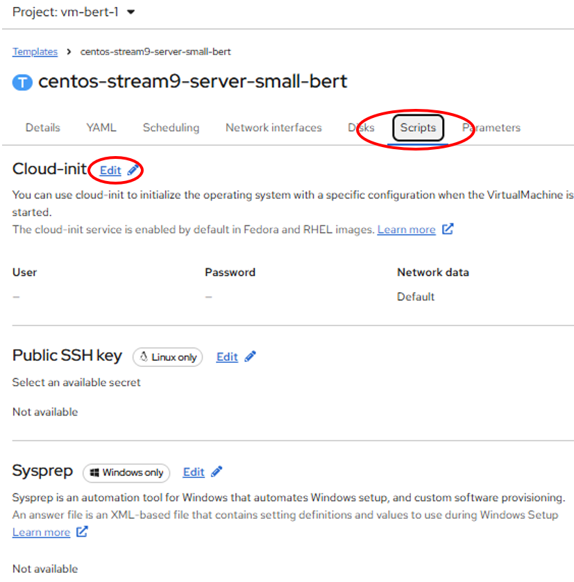
  
5. When the Cloud-init dialog opens, click the radio button to Configure in the **Scripts**. Replace the YAML with the following YAML snippet.

```yaml
userData: |-
 #cloud-config
 user: centos
 password: ${CLOUD_USER_PASSWORD}
 chpasswd: 
   { expire: False }
 packages:
  - mariadb-server
  runcmd:
  - systemctl enable mariadb
  - systemctl start mariadb
```

### Remove the operator labels (Optional)

**A cloned template can retain labels indicating that it is managed by the OpenShift Virtualization Operator. Remove the relevant operator-management labels so that the custom template is treated as user-managed rather than operator-managed.**
You can change the `metadata.labels` from the **details** tab or from the **YAML** tab. We will make the change in the **YAML** tab

6. Open the template's **YAML** tab.
7. Under `metadata.labels`, delete any of these that are present:
   - `app.kubernetes.io/managed-by: ssp-operator`
   - `app.kubernetes.io/part-of`
   - `app.kubernetes.io/version`
   - `app.kubernetes.io/component`
8. Under `metadata.annotations` , delete `operator-sdk/primary-resource` and `operator-sdk/primary-resource-type`. **(not present in the example)**
9. Keep `template.kubevirt.io/type: VM`. The console needs it to list the template.
101. Click the **Save** button, you will see a green Saved prompt, then follow that by clicking the Apply button.


---

### Create a VM from a customized template

> **Note:** Since OpenShift Virtualization 4.22, VM creation cannot start from the template details page anymore. Start from **Virtualization → VirtualMachines → Create**, and then select **Create from Template** in the creation wizard.

1. In the OpenShift web console, select **Virtualization → VirtualMachines**.
2. Select your project "VM-<your name>-1.
3. Click **Create**.

The VM creation wizard provides different creation methods, including creating a VM with a custom configuration, creating a VM from a template, and cloning an existing VM.

4. **Deployment details:** choose **Create from Template**, enter a VM name, and check that **Location** shows the target project. Click **Next**.

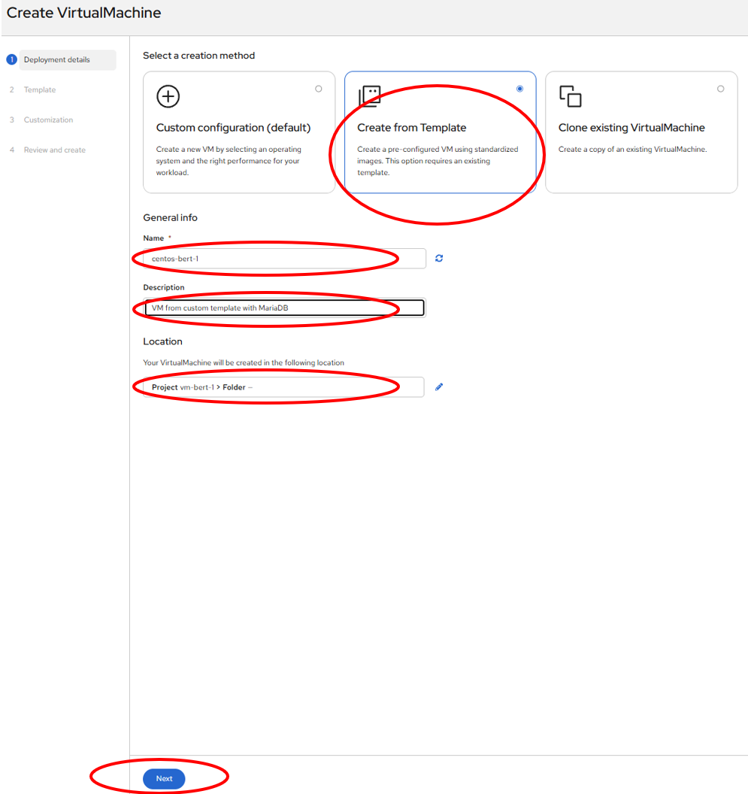

5. **On the Templates page:** open the **Filter** dropdown and switch to **User templates** (or **All templates**). Keep the project selector on **All projects**. 

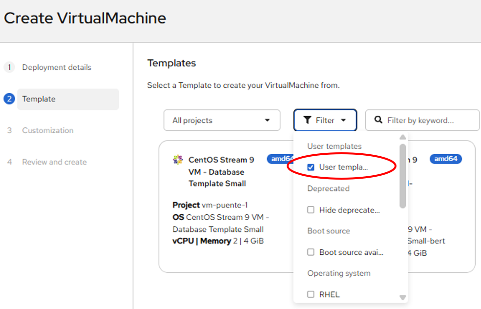

7. Select your template:  `centos-stream9-server-small-<your name>`

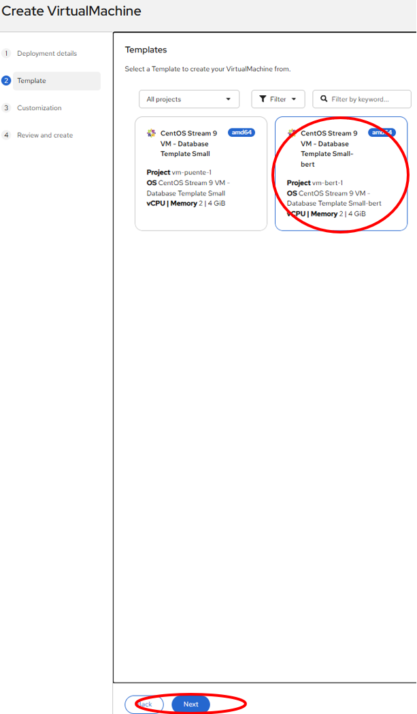

- Click **Next**.

6. **Customization:** change CPU, memory, disk, or SSH key for this VM only, if needed. Click **Next**.
Verify that the VM has:
- **CPU:** 2 vCPUs
- **Memory:** 4 GiB

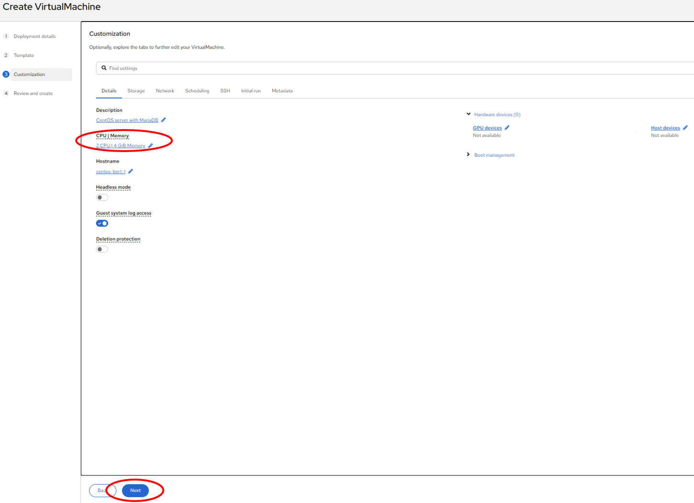

- Click **Next**

7. **Review and create:** tick **Start this VirtualMachine after creation** (cloned templates create VMs stopped).

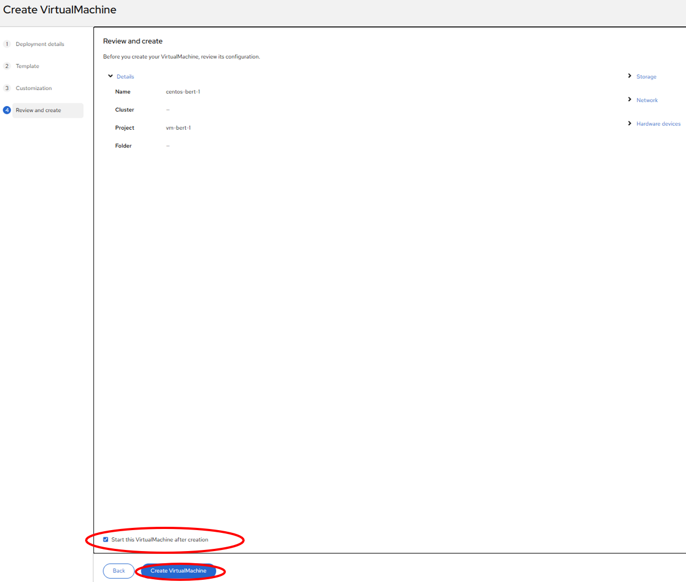

click **Create VirtualMachine**


### Verify the configuration

On the VM details page, verify:

- VM status
- CPU
- Memory
- Boot source
- Disks
- Network interfaces

Confirm that the VM received the configuration defined in the customized template.

You have now used a Red Hat-provided template as the basis for an editable custom template and created a VM from that template through the VM creation wizard.

---

## Working with InstanceTypes

Templates are useful when you want to standardize a broader VM configuration. **InstanceTypes** address a different requirement: **standardized compute sizing**.

An InstanceType defines CPU and memory resources so that users can select a predefined VM size rather than manually specifying CPU and memory for each VM.

For example, predefined InstanceType series can include general-purpose, memory-intensive, or compute-oriented configurations.

### Explore the Available InstanceTypes

1. In the OpenShift web console, select **Virtualization → InstanceTypes**.
2. Review the InstanceTypes available in the cluster.
3. Look at the different InstanceType series and sizes.

For this exercise, locate the **u1** series, which is intended for general-purpose workloads.

### Examine an InstanceType

OpenShift Virtualization provides predefined InstanceTypes that define reusable compute configurations for virtual machines.

An InstanceType can be either:

- **Cluster-wide:** `VirtualMachineClusterInstanceType`
- **Project-specific:** `VirtualMachineInstanceType`

The difference is mainly scope. Both define reusable VM compute characteristics such as CPU and memory, but one is available cluster-wide while the other belongs to a specific OpenShift project.
The predefined `u1.medium` InstanceType is a cluster-wide InstanceType.

### Open the InstanceType

- In the OpenShift web console, select **Virtualization → InstanceTypes**.
- Locate:

  `u1.medium`

- Click the InstanceType to open it.
- Review the **Details** tab.

The Details page mainly displays metadata about the InstanceType, including its name, labels, annotations, creation date, and owner. In the current OpenShift Virtualization console, the complete compute specification is not presented as separate fields on this page.

The labels provide a summary of the InstanceType. For `u1.medium`, the labels show:

- **Class:** General purpose
- **Size:** Medium
- **CPU:** 1 vCPU
- **Memory:** 4 GiB
- **Vendor:** Red Hat

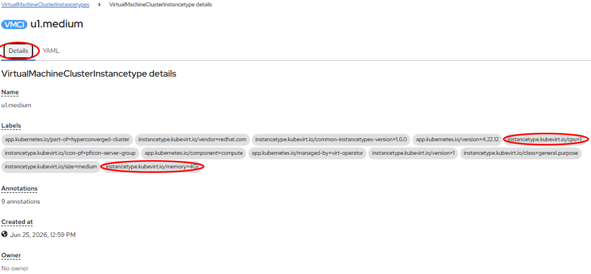

> **Note:** It is normal that the Details page does not show the complete InstanceType configuration in a dedicated CPU and memory section. The YAML definition is the authoritative configuration.

### Review the InstanceType configuration

- Select the **YAML** tab.
- Locate the `spec` section.
- Review the CPU and memory values.

The YAML definition contains the resource configuration applied to a VM that uses this InstanceType. The relevant section is similar to the following example:

```yaml
spec:
  cpu:
    guest: 1
  memory:
    guest: 4Gi
```

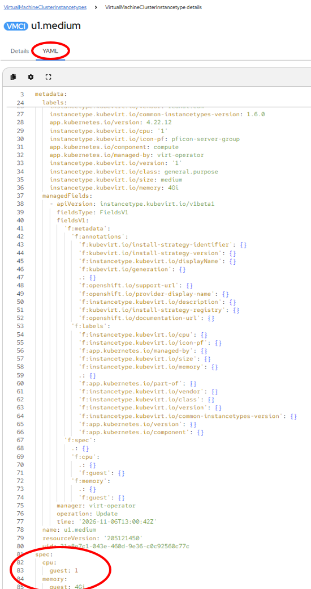

### Key takeaway

The **Details** tab provides a metadata summary, while the **YAML** tab contains the complete InstanceType specification. Learners do not need to understand every field in the YAML. For this tutorial, focus on the `spec.cpu.guest` and `spec.memory.guest` values and explain how these values determine the VM's compute size.

---

### Create a VM Using an InstanceType

Now create a second VM, this time using an InstanceType.

1. Select **Virtualization → VirtualMachines**.
- Select your project: `VM-<your name>-1`
- Click **Create**.
2. Select the option for creating a VM using a **Custom configuration**.
3. Fill in:
- Name: `fedora-"yourname"-it1`
- Description: `VM created using instancetype`
- Location: your project `VM-<your name>-1`

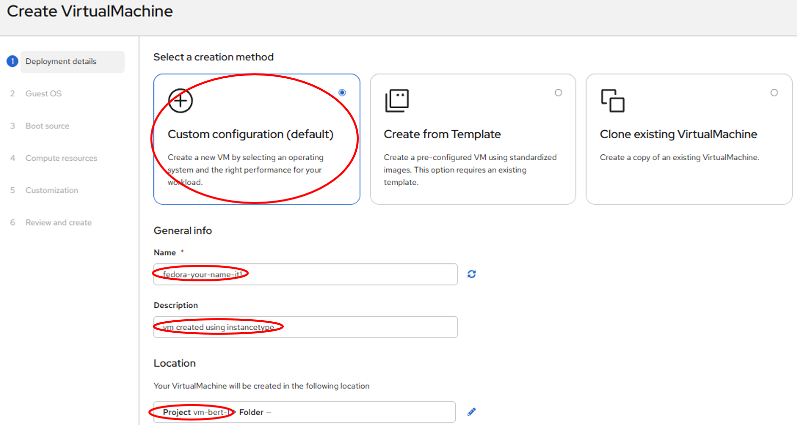

### Select the operating system

An InstanceType defines the compute configuration, but the VM still requires a boot source.

1. Select an operating system image available in the ROVS environment, for example:

- Guest Operating System; `Other linux`
- Guest Operating System type: `fedora`

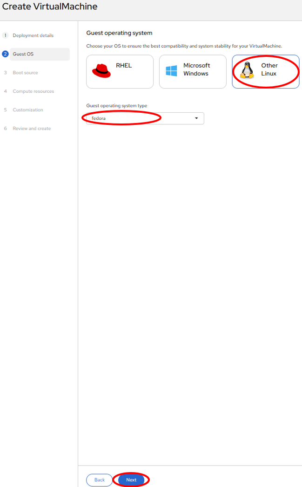

2. Click Next

> **Note:** The operating system images available to you depend on the boot sources configured in the cluster.

3. Choose the boot source 

- Volume Name: `fedora`
- Namespace: `openshift-virtualization-os-image`

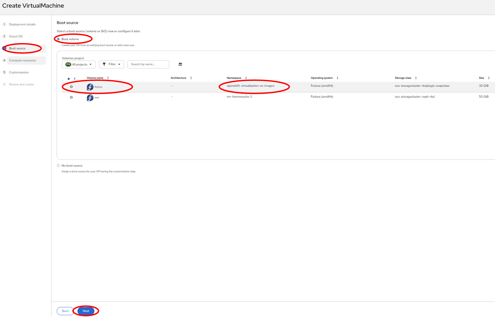

4. Click Next

### Select the InstanceType

1. Select: `u1 - medium`

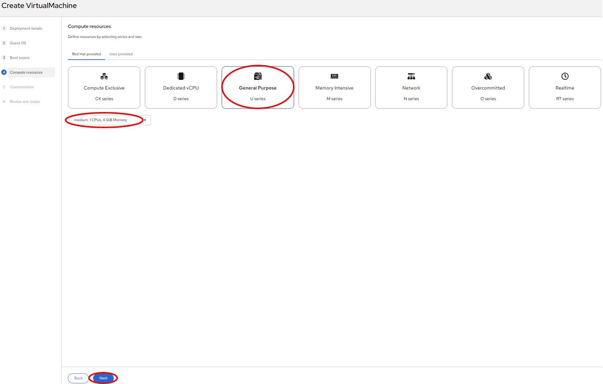

### Customization

1. Click Next

### Review and create

1. Review the VM configuration, including:

- VM name
- Storage
- Network interfaces

The **InstanceType controls the compute sizing**, while the remaining VM configuration is defined separately.

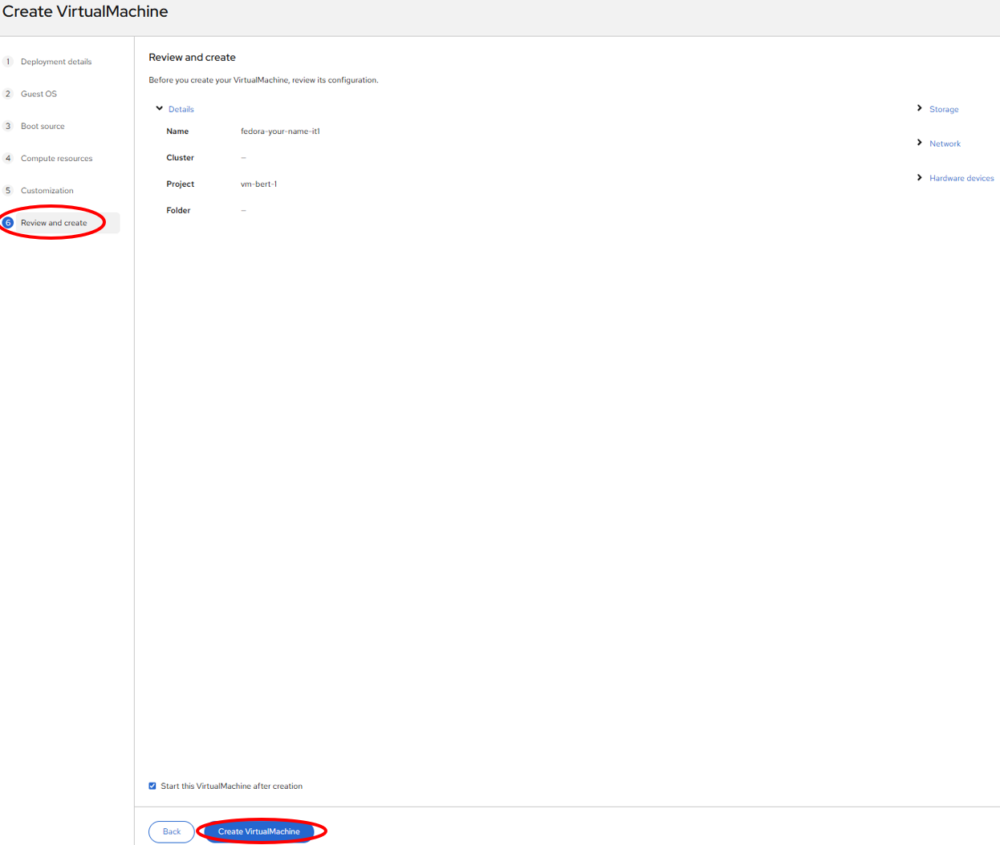

2. Click Create VirtualMachine


### Templates and InstanceTypes Compared

You have now created VMs using two different approaches.

| | **Template** | **InstanceType** |
|---|---|---|
| Purpose | Standardize VM configuration | Standardize compute sizing |
| CPU and memory | Can be predefined | Defined by the InstanceType |
| Operating system | Can be predefined | Selected separately |
| Disks | Can be predefined | Configured separately |
| Networking | Can be predefined | Configured separately |
| Typical use | Repeatable workload configuration | Standard VM sizes |

The key distinction is:

> **Templates standardize a VM configuration. InstanceTypes standardize the amount and characteristics of compute assigned to a VM.**

Templates and InstanceTypes are not necessarily competing approaches. InstanceTypes can also be used as building blocks in standardized VM deployment workflows.

---

### Cleanup

To save resources for the next lab, please stop any VMs that you created in this module.
- Navigate to **Virtualization → VirtualMachines**.
- Select the project containing the VMs that you created during this tutorial.
- If any VMs have a status of **Running**, select the VM and click **Stop**, or select **Stop** from the **Actions** menu.

All VMs created during this tutorial should now be in the **Stopped** state.

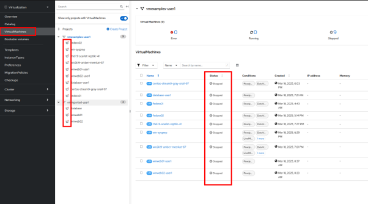

---

### What You Have Learned

In this tutorial, you learned how to:

- Explore Red Hat-provided VM templates.
- Understand why Red Hat-provided templates cannot be edited directly.
- Create a custom template based on a Red Hat-provided template.
- Customize the new template for a specific workload.
- Create a VM from the customized template.
- Explore the InstanceTypes available in OpenShift Virtualization.
- Understand how InstanceTypes standardize CPU and memory.
- Create a VM using an InstanceType and an operating system image.
- Understand the different roles of Templates and InstanceTypes.
