# OpenShift API for Data Protection (OADP) Backup Lab

> Estimated duration: 60 minutes

## Introduction

In this lab, you will learn how to back up and restore an OpenShift Virtualization virtual machine (VM) using OpenShift API for Data Protection (OADP) and IBM Cloud Object Storage (COS).

An OpenShift Virtualization VM consists of Kubernetes resources that define the VM and persistent volumes that store its operating system and data. A complete backup must protect both to ensure successful recovery.

## How it works

OADP, built on Velero, coordinates the backup and restore process using the following components:

- **OADP / Velero**: Orchestrates backup and restore operations for Kubernetes resources and VM configuration. [Learn more about Velero](https://velero.io/blog/velero-is-an-open-source-tool-to-back-up-and-migrate-kubernetes-clusters/).
- **CSI Snapshots**: Capture point-in-time snapshots of the VM's persistent volumes. [Learn more about CSI](https://kubernetes-csi.github.io/docs/).
- **OADP Data Mover / Kopia**: Transfers persistent volume data to external object storage.
- **IBM Cloud Object Storage**: Provides durable backup storage independent of the OpenShift cluster.
- **NonAdminBackup / NonAdminRestore**: Enable authorized users to manage backups and restores without cluster-admin privileges.

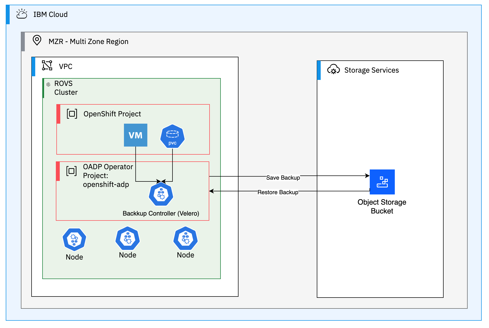

## Lab Objectives

During this hands-on lab, you will:

1. Prepare an OpenShift Virtualization VM for backup.
1. Create and monitor an OADP backup of the VM and its persistent volumes.
1. Delete the original VM to simulate data loss.
1. Restore the VM and its persistent volumes.
1. Verify that the VM and its data have been successfully recovered.

## Environment Preparation by the Cluster Administrator

The cluster administrator has already configured the backup infrastructure:

- **OADP Operator and Velero** for backup and restore orchestration.
- **Data Protection Application (DPA)** and a validated Backup Storage Location (BSL).
- **IBM Cloud Object Storage bucket** for external backup storage.
- **HMAC credentials**, managed through IBM Cloud Secrets Manager and exposed to OADP through a Kubernetes Secret.
- **CSI snapshot and data mover capabilities** to protect and transfer persistent volume data.
- **Role-based access control (RBAC)** to allow lab users to perform backup and restore operations without cluster-admin privileges.

**The environment is ready to use**. No infrastructure configuration or cluster-administrator access is required to complete the exercises.

## OADP vs. Enterprise Backup Solutions

OADP provides Kubernetes-native backup and restore capabilities. For production environments requiring centralized policies, monitoring, retention, compliance, and enterprise-wide recovery management, consider solutions such as Veeam Kasten, Veeam Backup & Replication, or IBM Cloud Backup and Recovery Service (BRS).

[Learn more about OpenShift Virtualization resiliency and backup solutions](https://cloud.ibm.com/docs/virtualization-solutions?topic=virtualization-solutions-virt-sol-openshift-resiliency-design)

## Prerequisites

Before starting, ensure you have access to:

- An OpenShift cluster with OpenShift Virtualization.
- OADP installed and Data Protection Application (DPA) already configured
- A VM to back up. [(Use the Fedora VM created in lab 1)](./vm-management)

## Lab Environment

The following resources will be used thoughout this exercises:  
  
| Parameter | Value |
| --- | --- |
| OpenShift project | `vm-lastname-1` |
| VM name | `fedora01` |
| OADP project | `openshift-adp` |

Let's set those variables for later use

```sh
export VM_NAME="fedora01"
export OC_PROJECT="<replace-by-your-project>"
```

## Lab Exercise

You will now perform an end-to-end backup and restore of your Fedora VM using OADP, CSI snapshots, and IBM Cloud Object Storage.

The exercise covers preparing the VM, creating a backup, deleting the original VM to simulate data loss, and restoring it. You will then verify that both the VM configuration and its persistent data have been recovered to the state captured by the backup.
  
## Prepare an additional VM Disk for Backup

In this exercise, you will attach and configure an additional 10 GiB disk on your Fedora VM. This disk will be used to store test data and verify that persistent storage is successfully recovered during the OADP backup and restore lab.

> Important: If your VM already has an additional disk, skip the disk creation steps and proceed to Step 2: Identify the Additional Disk. If the disk already contains a filesystem or data, do not repartition or format it.

1. In the **OpenShift Console**, navigate to **Virtualization -> Virtual Machines** and select your VM.

1. Open the **Configuration** tab, select **Storage**, and click **Add**

    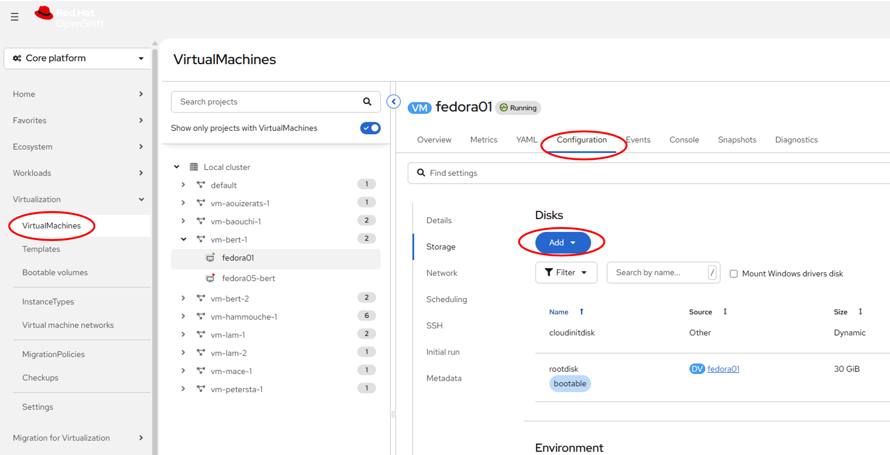

1. Select **Empty disk** to create a new persistent disk.

    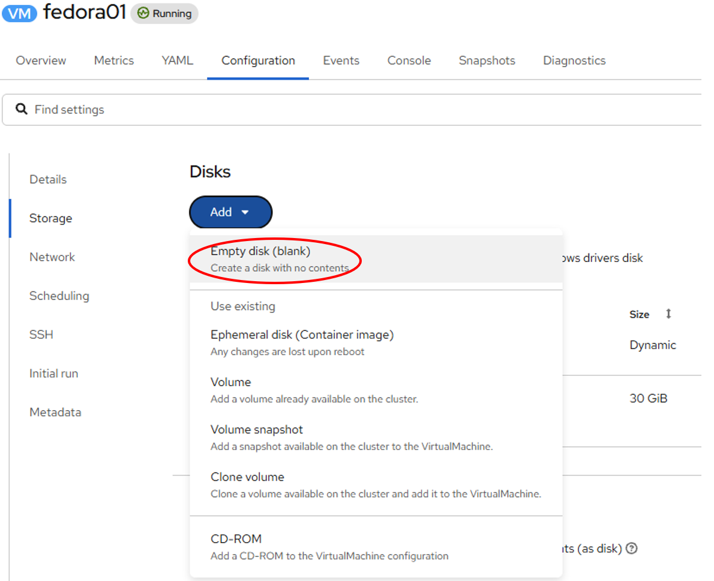

1. Configure the disk with the following settings:

   - **Name**: fedora01-disk2
   - **Size**: 10 GiB
   - **Interface**: virtio
   - **StorageClass**: Select the Ceph RBD virtualization storage class `ocs-storagecluster-ceph-rbd-virtualizationshown`.

   - 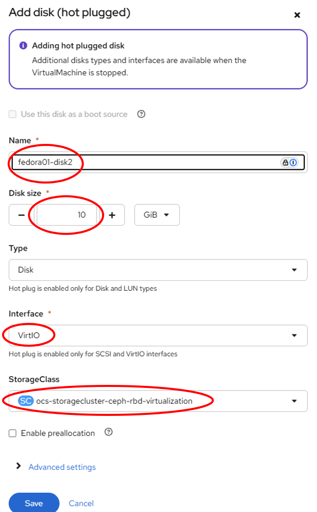

1. Click **Save** and wait for the disk to be provisioned and attached to the VM.

    > The additional disk should now appear under Configuration → Storage.

1. Open the VM Console in the OpenShift Console

    > An alternative is to connect to your console in your own terminal using the command: `virtctl console fedora01`

1. Run this command which lists the available block devices, their partitions, filesystem types, and mount points.

    ```sh
    lsblk -o NAME,SIZE,TYPE,FSTYPE,MOUNTPOINTS
    ```

    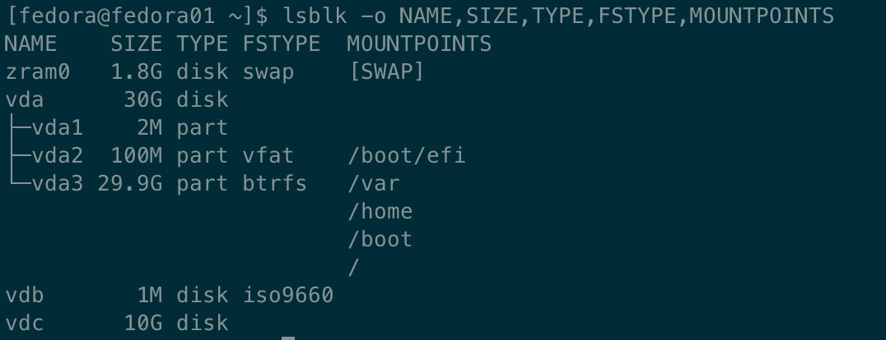

1. Identify the additional 10 GiB disk by comparing the output with the VM's storage configuration. In this example, the additional disk appears as /dev/vdc.

1. Partition the New Disk. A newly created empty disk must be partitioned before creating a filesystem.

    ```sh
    sudo fdisk /dev/vdc
    ```

1. At the fdisk prompt, enter the following commands:

    | Command | Description |
    | --- | --- |
    | `g` | Create a new GPT partition table |
    | `n` | Create a new partition |
    | `Enter` | Accept the default partition number |
    | `Enter` | Accept the default first sector |
    | `Enter` | Accept the default last sector, using all available space |
    | `w` | Write the changes to disk and exit |

1. Verify the partition

    ```sh
    lsblk -f
    ```

    > You should now see a disk and its partition, similar to:

    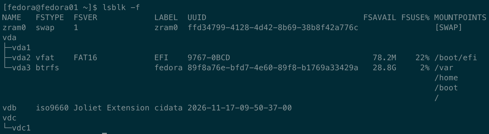

    The new partition `/dev/vdc1` is now ready to be formatted.

1. Format it as XFS, which is a Linux filesystem suitable for storing the test data used in this lab.

    ```sh
    sudo mkfs.xfs -L data /dev/vdc1
    ```

1. The filesystem must be mounted before applications can read or write data to it. Create a directory that will serve as the mount point:

    ```sh
    sudo mkdir -p /data
    ```

1. Mount the partition:
  
    ```sh
    sudo mount /dev/vdc1 /data
    ```

1. Verify that the disk is mounted:

    ```sh
    df -h /data
    ```

    > The output should show the additional disk mounted at /data, with approximately 10 GiB of capacity.
    > The additional disk is now accessible through the /data directory.

1. Make the mount persistent. By default, a disk mounted manually with the mount command may not be mounted automatically after a VM restart.

    > To ensure that /data remains available after reboot, configure the filesystem in /etc/fstab using its UUID (Universally Unique Identifier).

    ```sh
    sudo blkid /dev/vdc1
    ```

    > Example output:
    /dev/vdc1: LABEL="data" UUID="1234abcd-..." TYPE="xfs"

1. Alternatively, retrieve the UUID into a shell variable:

    ```sh
    UUID=$(sudo blkid -s UUID -o value /dev/vdc1)
    echo "$UUID"
    ```

    > Save this UUID for the next step.

1. Update /etc/fstab

    ```sh
    sudo nano /etc/fstab
    ```

1. Add the following line, replacing the example UUID with the actual value returned by blkid above:

    UUID=5f24d492-fc7b-406f-b103-9e2df8a6b0e0 /data xfs defaults 0 0

    It should look like this:

    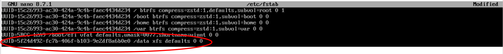

    exit nano while saving changes
    Ctrl+O enter
    Ctrl+X

1. Test the configuration before rebooting

    ```sh
    sudo umount /data
    sudo mount -a
    df -h /data
    ```

    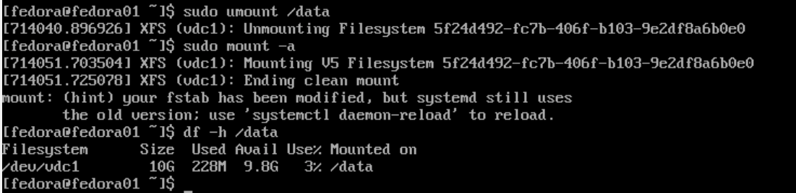

    > If that works without errors, the disk will automatically mount at /data after a reboot.

1. Identify the disks. Inside the VM, run:  
  
    ```sh
    lsblk -f
    ```

    In this example, the secondary disk is `/dev/vdc`, with an XFS partition /dev/vdc1 already mounted at /data.
    Adjust the device name to match your environment.  
  
    ```sh
    sudo mkdir -p /mnt/vdc
    ```

1. Retrieve the disk UUID

    You should have stored the UUI before when editting the FSTAB  

    ```sh
    sudo blkid /dev/vdc1  
    ```

    Alternatively, retrieve the UUID directly into a variable:  

    ```sh
    UUID=$(sudo blkid -s UUID -o value /dev/vdc1)
    ```

    Verify the value:  

    ```sh
    echo $UUID
    ```

    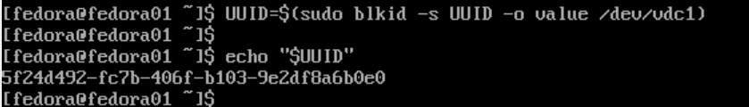

## Verify SELinux on Fedora / RHEL

The QEMU Guest Agent (qemu-ga) enables communication between OpenShift Virtualization and the guest operating system. On Fedora and RHEL, SELinux may restrict the agent's access to files inside the VM.

For this OADP backup and restore lab, verify that the QEMU Guest Agent has the necessary permissions to interact with the guest filesystem.

**Why is this relevant to your OADP backup/restore lab?**

The important concept is that there are two different layers involved:

OpenShift / VM outside → KubeVirt / OpenShift Virtualization
 → QEMU
 → QEMU Guest Agent
 → Fedora VM filesystem

The QEMU Guest Agent runs inside the Fedora VM and provides a communication channel between the virtualization platform and the guest operating system.
SELinux normally confines the guest-agent process (virt_qemu_ga_t). The policy deliberately has this Boolean disabled by default, following the least-privilege principle.
For a backup/restore lab, broader guest-agent access can be needed so virtualization/backup operations that interact with the guest filesystem are not blocked by SELinux.

**One important distinction**

This command does not:

- give OpenShift unrestricted access to your VM
- disable SELinux
- make SELinux permissive
- expose /data over the network
- directly back up /data

1. Check the SELinux boolean. Run the following command inside the Fedora/RHEL VM:

    ```sh
    getsebool virt_qemu_ga_read_nonsecurity_files
    ```

    By default, the Boolean may be disabled:
    virt_qemu_ga_read_nonsecurity_files --\> off  

1. Enable File Access for the QEMU Guest Agent

    If the Boolean is disabled, enable it:

    ```sh
    sudo setsebool -P virt_qemu_ga_read_nonsecurity_files on
    ```

    Verify the setting:  
  
    ```sh
    getsebool virt_qemu_ga_read_nonsecurity_files
    ```

    > Expected output:  
    virt_qemu_ga_read_nonsecurity_files --\> on  

    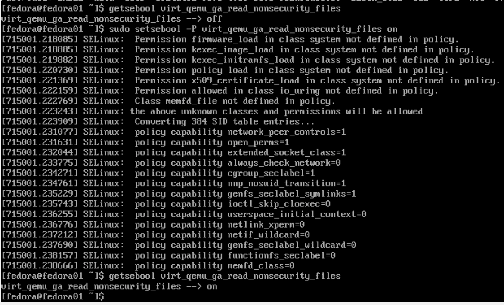

## Create Test Data Inside the VM

We will now create some test data inside the VM to demonstrate after the restore that the contents of the different volumes have been correctly recovered.  

1. Create test data on the system disk. On the console of the Fedora VM:

    ```sh
    echo "root-before-backup" | sudo tee /root/test-root.txt
    ```

1. Create test data on the secondary disk

    ```sh
    echo "vdc-before-backup" | sudo tee /data/test.txt
    ```

1. Verify both files:  

    ```sh
    sudo cat /root/test-root.txt  
    sudo cat /data/test.txt
    ```

    > Expected output:  
    root-before-backup
    vdc-before-backup  

## Label the VM

Use a label to select only the VM that needs to be backed up.

1. On the **OpenShift Console - Virtualization - VirtualMachines**, select the `fedora01` VM and on the `Configuration` tab in Metadata click `Edit` for the labels. Add the label `backup=vm-to-backup` to the labels

    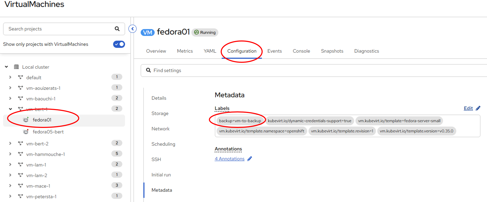

1. Label the PVC

    Because the backup uses a label selector, it is recommended to put the same dedicated backup label on both the VM and the PVC.
    On the **OpenShift Console - Storage - PersistentVolumeClaims**

    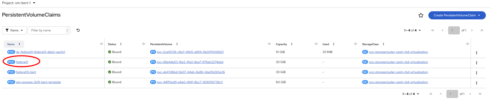
    Select the `fedora01` PVC.

    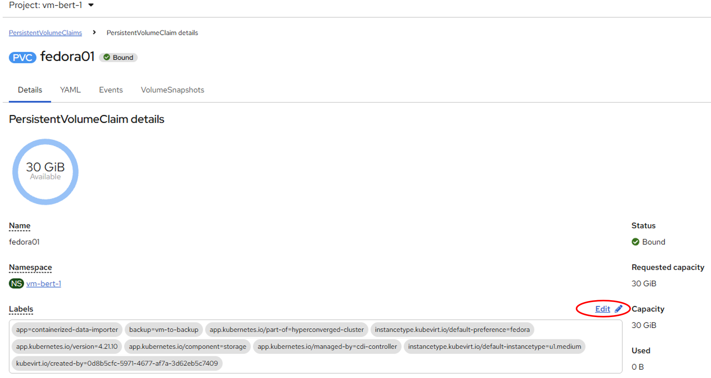

    In the Labels click `Edit` for the labels to add "backup=vm-to-backup" to the labels and `Save`

    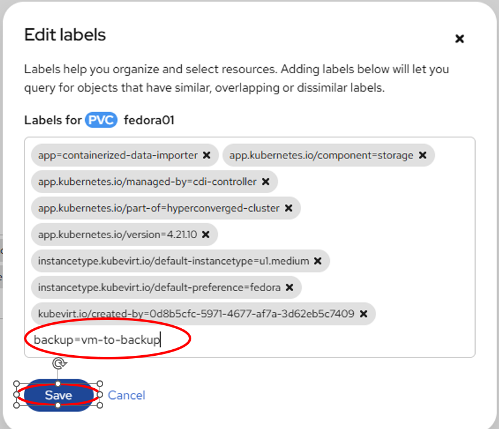

    > The OpenShift web console is used as the primary method in this lab. Equivalent oc commands are provided as an alternative.
    > oc label vm fedora01 -n $OC_PROJECT backup=vm-to-backup --overwrite
    > oc label pvc fedora01 -n $OC_PROJECT backup=vm-to-backup --overwrite

## Create the OADP Backup

The backup is created using a **NonAdminBackup** resource. A NonAdminBackup allows a namespace-scoped user to create an OADP backup without directly creating or managing the underlying Velero backup resources.

The VM that was labeled in the previous step will be selected using:
app="vm-to-backup" (app=fedora01)

1. On to the **OpenShift Console**, Select the **Project** containing the VM.

1. Navigate to: Home → Search, search for: **NonAdminBackup** and click `Create NonAdminBackup`.

    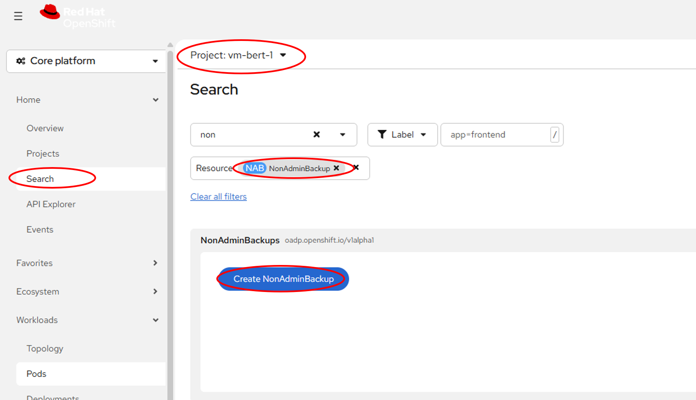

1. Enter the following YAML configuration. Make sure to enter your OpenShift project.

    ```yaml
    apiVersion: oadp.openshift.io/v1alpha1
    kind: NonAdminBackup
    metadata:
      name: backup-vm-to-backup-01
      namespace: vm-bert-1
    spec:
      backupSpec:
        includedNamespaces:
          - vm-bert-1
        labelSelector:
          matchLabels:
            backup: vm-to-backup
        snapshotMoveData: true
    ```

    > In the above replace:
    - name: backup-vm-to-backupname --> "backup-fedora01-your name-01"
    - your-namespace with your namespace/project containing the VM --> "vm-yourlastname-1"

    > Important: includedNamespaces contains the namespace to be backed up, not the VM name. The VM itself is selected using the backup=vm-to-backup label.

    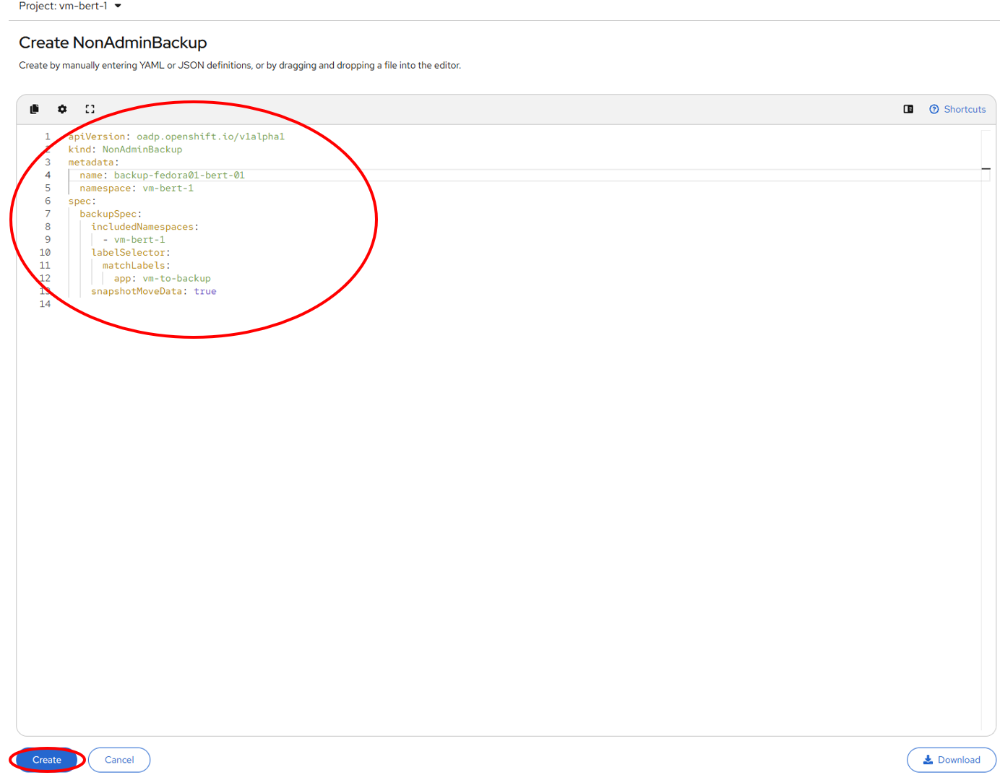

1. Click Create. The backup will be `Queued` and eventually `Accepted`.

    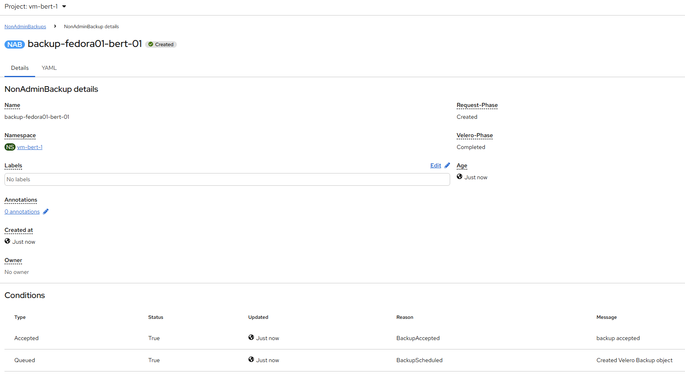

    > Backup Naming Convention: Use a unique name for each new backup. For example:
    backup-fedora01-bert-01
    backup-fedora01-bert-02
    backup-fedora01-bert-03
    This makes it easy to identify individual backup operations.

1. CLI Alternative
     Instead of creating the NonAdminBackup resource through the OpenShift web console, the same resource can be created using the oc CLI by storing the yaml file and running the command `oc apply -f backup-vm.yaml`

## Monitor the Backup

After creating the NonAdminBackup, monitor the backup until it successfully completes.

### Monitor the NonAdminBackup Using the OpenShift Web Console

1. Navigate to Home → Search, search for: `Backup`
    Select the appropriate **NonAdminBackup**, for example:
    backup-vmname-yourlastname-01
    Review the Details and YAML tabs to monitor the backup status.

    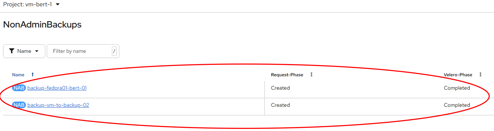
    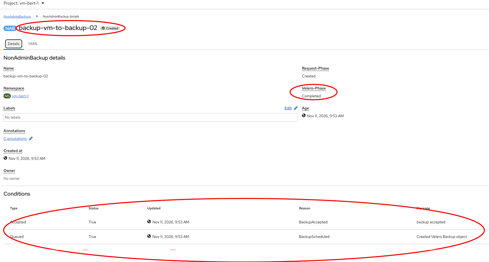

    The NonAdminBackup represents the backup request. OADP uses the underlying Velero and storage components to perform the actual backup.

    - During execution, the backup can progress through states such as: `InProgress` or `WaitingForPluginOperations`
    - The expected final state is:     Completed
    - The backup should not finish in:    PartiallyFailed

1. List the Velero backups using the CLI

    ```sh
    oc get backup.velero.io -n openshift-adp
    ```

1. After identifying the appropriate backup, check its status:

    ```sh
    oc get backup.velero.io <backup-name> \
      -n openshift-adp \
      -o custom-columns=NAME:.metadata.name,PHASE:.status.phase,ERRORS:.status.errors
    ```

    > Replace: <backup-name> with the actual NonAdminBackup backup resource name.

## Monitor the DataUploads using the OpenShift Web Console

The backup configuration includes snapshotMoveData: true, which instructs OADP/Velero to transfer persistent volume snapshot data to the configured backup storage.

During this process, DataUpload resources are created to track the transfer of volume data.

To verify that the data transfer completed successfully, use the OpenShift Web Console to inspect the YAML of the executed NonAdminBackup and check the status of the associated DataUpload resources.

1. Navigate to Home → Search and search for: NonAdminBackup

    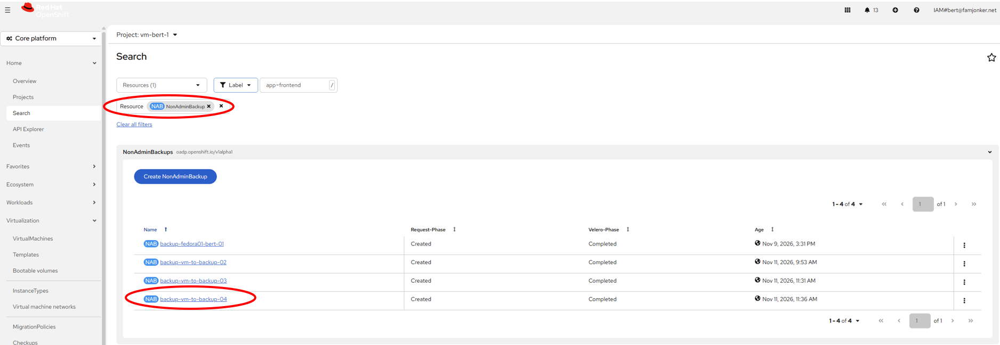

1. Select your last executed backup. Go to the `YAML` tab and search for `dataMoverDataUploads`

    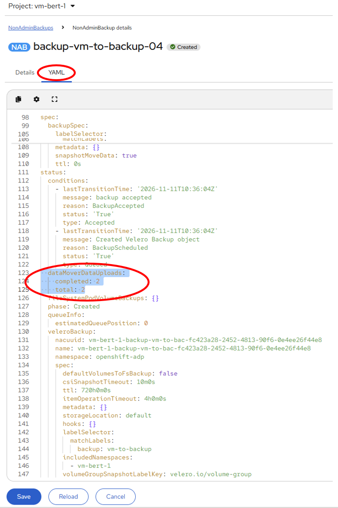

    > You should find :  
    completed: 2
    total: 2

1. List the DataUpload resources using the CLI

    ```sh
    oc get datauploads -n openshift-adp
    ```

1. For additional information:

    ```sh
    oc get datauploads -n openshift-adp -o wide
    ```

    > The DataUpload resources should eventually reach: **Completed**

1. Let's verify that the Backup has completed Successfully

    > The NonAdminBackup has completed successfully.
    The underlying Velero backup has reached Completed.
    The required DataUpload resources have reached Completed.
    No significant backup errors are reported.
    The expected result is:
    Backup:      Completed
    DataUploads: Completed
    The backup should not report: PartiallyFailed

1. To troubleshooting the backup, inspect the underlying NonAdminBackup resource. In the **OpenShift Web Console**, navigate to: Home → Search → NonAdminBackup

1. Open the appropriate backup and inspect its Details and YAML.

    > Pay particular attention to:
    Phase
    Errors
    Warnings
    Backup Item Operations
    Hook Status
    DataUpload Status
    These fields can help identify whether the problem occurred while selecting resources, taking volume snapshots, running VM hooks, or moving persistent volume data.

1. Display detailed information about the backup:

    ```sh
    oc describe backup.velero.io -n openshift-adp <backup-name> \
    ```

    > Review the output for:
    Phase
    Errors
    Warnings
    Backup Item Operations
    Hook Status

1. If necessary, also inspect the DataUpload resources:

    ```sh
    oc describe dataupload -n openshift-adp <dataupload-name> \
    ```

    > Do not continue with the restore procedure until the backup has completed successfully.
    The purpose of your exercise is to demonstrate recovery after loss of the VM. So the clean sequence should be: Successful backup

1. Make the post-backup change for point-in-time testing. Stop the VM
Delete the VM and its associated storage that you intend to recover
Create the NonAdminRestore
Wait for the restore to complete
Start the restored VM if necessary
Verify the restored data and point in time

This avoids conflicts between resources already existing in vm-bert-1 and resources that OADP/Velero is trying to recreate. Red Hat documents OADP/Velero as the mechanism for restoring OpenShift Virtualization VM resources and persistent data.

## Stop and Delete the VM

The purpose of your exercise is to demonstrate recovery after loss of the VM. So a clean sequence should be:

- Successful backup
- Make the post-backup change for point-in-time testing
- Stop the VM
- Delete the VM and its associated storage that you intend to recover
- Create the NonAdminRestore
- Wait for the restore to complete
- Start the restored VM if necessary
- Verify the restored data and point in time

This avoids conflicts between resources already existing in you namespace and resources that OADP/Velero is trying to recreate.

### Stop VM before delete

1. In the **OpenShift console** navigate to: Virtualization → VirtualMachines → "your-vm-name"

1. Click: Actions → **Stop**. Wait until the VM shows: **Stopped**

    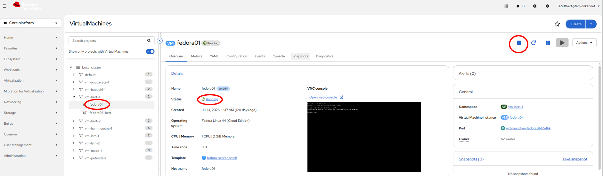
    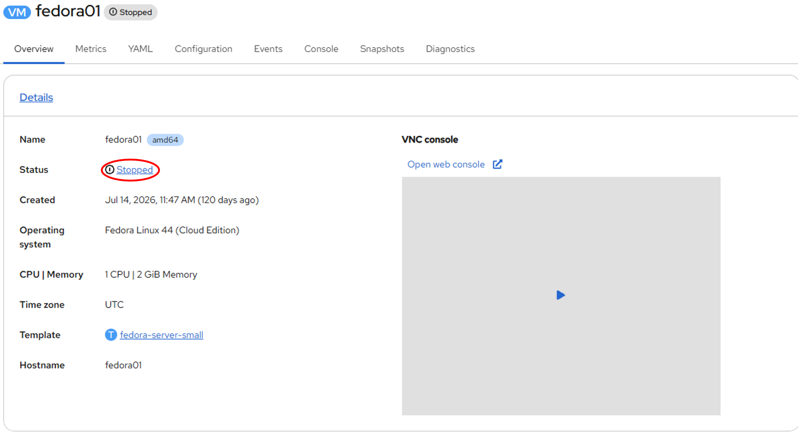

1. Then, **Delete** the VM as required by the lab's disaster/recovery scenario.

    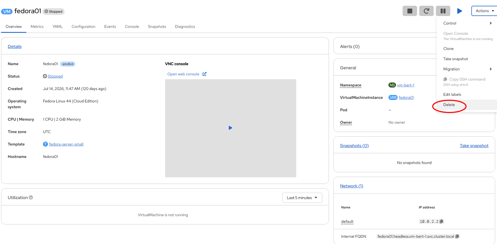

    > Why stopping first is useful?
    Stopping the VM prevents further disk writes before the recovery test. OpenShift Virtualization supports snapshots of running VMs, but the QEMU Guest Agent is recommended to quiesce the filesystem and improve data consistency.

## Restore the VM

The VM will now be restored from the previously created NonAdminBackup.

A NonAdminRestore allows a namespace-scoped user to restore an OADP backup without requiring direct access to the underlying Velero resources in the openshift-adp namespace. The OADP non-admin controller validates the restore request and creates the corresponding Velero Restore on behalf of the user.

The restore should recreate the Kubernetes resources that define the VM and restore its persistent volume data from the backup.

### Create the Restore Using the OpenShift Web Console

1. Select the project containing the original VM. For example: "vm-bert-1"

1. Navigate to Home, Search for `NonAdminRestore`.

1. Select the NonAdminRestore resource.

    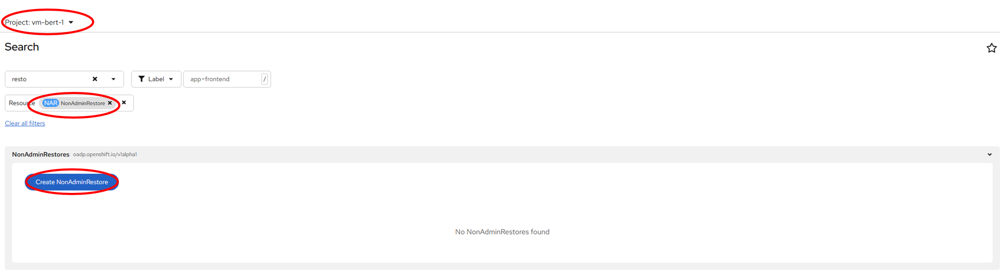

1. Click **Create NonAdminRestore**. In the YAML view, enter the following configuration:

    ```yaml
    apiVersion: oadp.openshift.io/v1alpha1
    kind: NonAdminRestore
    metadata:
      name: restore-vm-to-backup-01
      namespace: your-namespace
    spec:
      restoreSpec:
        backupName: backup-vm-to-backup-01
        restorePVs: true
    ```

    > Replace your-namespace --> with the namespace/project containing the vm-"your namespace"
    > Also replace backup-vm-to-backup-01 --> with the name of the NonAdminBackup that you want to restore.

    For example:

    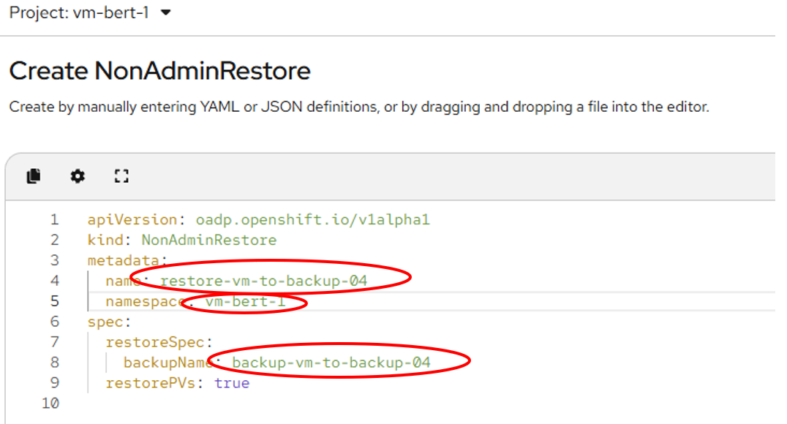

    Important: Select the backup that was successfully completed and for which the Data Mover operations completed.

### Monitor the Restore

Do not start or modify the restored VM until the restore has completed. Monitor the NonAdminRestore Using the OpenShift Web Console

1. Navigate to Home, search for: NonAdminRestore

1. Select your restore, for example: `restore-fedora01-bert-01`

1. Open the Details tab. Monitor the restore status until the underlying Velero restore reaches: `Completed`.

1. Also open the YAML tab and inspect the status section.

    Check for:

    - status
    - restore phase
    - errors
    - warnings
    - restored resources
    - Data Mover/DataDownload information, where available

    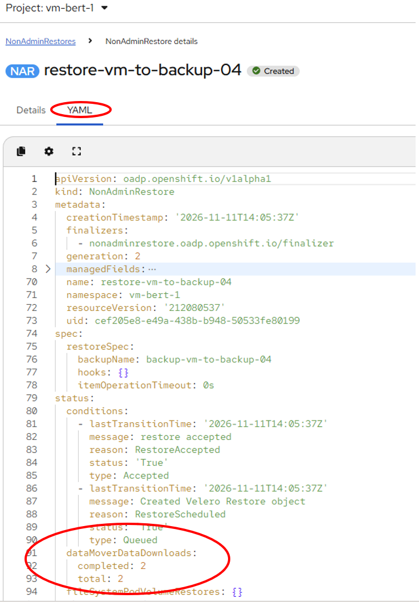

    The non-admin controller synchronizes Velero operation status back into the namespace-scoped self-service resource, allowing users to monitor operations without requiring access to the openshift-adp namespace.

10.3 CLI Alternative

1. Monitor the NonAdminRestore:

    ```sh
    oc get nonadminrestores -n openshift-adp -w
    ```

1. For additional details:

    ```sh
    oc describe nonadminrestore restore-vm-to-backup-01 \
    -n openshift-adp
    ```

1. If the individual DataDownload resources are available:

    ```sh
    oc get datadownloads -A
    ```

## Verify the Restored VM

After the restore completes, verify that the VM and its associated persistent storage have been successfully recovered.

1. In the **OpenShift Web Console**, select your project (for example, `vm-bert-1`).

1. Navigate to **Virtualization → VirtualMachines**.

1. Verify that the restored VM (for example, `fedora01`) is present.

1. Open the VM and verify that it is in the expected state.

1. Navigate to **Storage → PersistentVolumeClaims**.

1. Verify that:
   - The restored PVCs are present.
   - Each PVC has a status of `Bound`.
   - The expected labels have been restored.

    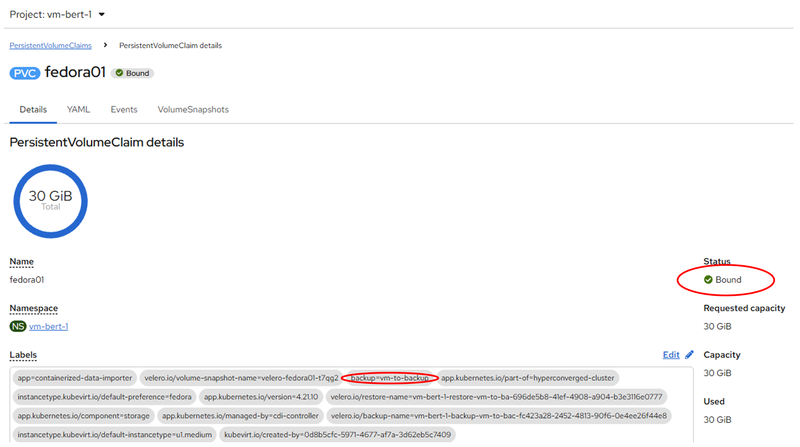

    OADP restores the Kubernetes resources that define the VM and the persistent storage associated with the protected workload.

> **Note:** Kubernetes-generated identifiers may differ from those used before deletion. The important validation is that the VM, its PVCs, and persistent data have been successfully restored.

## Verify the restored VM using the CLI

1. List the restored VM resources:

    ```bash
    oc get vm,vmi,dv,pvc -n $OC_PROJECT
    ```

1. To filter resources associated with the VM:

    ```bash
    oc get vm,vmi,dv,pvc -n $OC_PROJECT | grep fedora01
    ```

1. Verify the presence of the following resources:

    | Resource | Expected state |
    | --- | --- |
    | VirtualMachine (VM) | Present, `Running` if started |
    | VirtualMachineInstance (VMI) | `Running` when the VM is started |
    | DataVolume (DV) | `Succeeded` |
    | PersistentVolumeClaim (PVC) | `Bound` |

## Verify the Restored Data

After the VM has been restored and started, connect to its console.

This step verifies that both the VM configuration and the data stored on its disks have been recovered from the backup.

1. Verify the System Disk. Inside the Fedora VM, run:

    ```bash
    sudo cat /root/test-root.txt
    ```

    **Expected output:**

    ```text
    root-before-backup
    ```

    > This confirms that the test file on the system disk has been successfully restored.

1. Check that the secondary disk is mounted:

   ```bash
   findmnt /data
   ```

   The output should show `/dev/vdc1` (or its equivalent device) mounted at `/data`.

   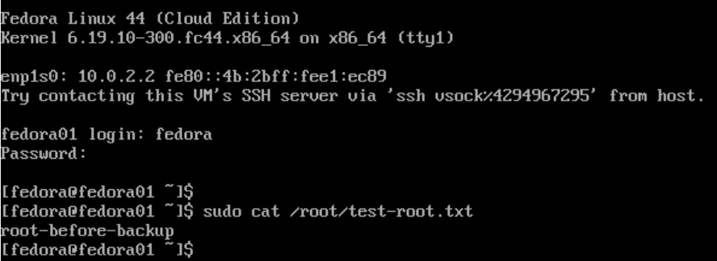

   > Because an `/etc/fstab` entry was configured before the backup, the secondary disk should mount automatically when the restored VM starts.

1. Verify the restored data:

   ```bash
   cat /data/test.txt
   ```

   **Expected output:**

   ```text
   vdc-before-backup
   ```

   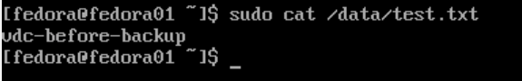

    > This confirms that the secondary disk is mounted and its persistent data has been successfully restored.

By completing this lab, you have demonstrated the following:

### Backup

- The VM and its PVCs are selected using the `backup=vm-to-backup` label.
- Existing CDI-managed labels, such as `app=containerized-data-importer`, remain unchanged.
- CSI snapshots protect the VM's persistent storage.
- `snapshotMoveData: true` enables the transfer of snapshot data to the configured backup storage.
- OADP Data Mover transfers the protected volume data to IBM Cloud Object Storage.
- The `NonAdminBackup` and associated DataUpload operations complete successfully.

### Restore

- The original VM can be deleted to simulate data loss.
- A non-admin user can initiate recovery using `NonAdminRestore`.
- OADP/Velero recreates the VM's Kubernetes resources and restores its persistent volumes.
- The associated DataDownload operations complete successfully.
- The restored PVCs return to the `Bound` state.

### Data Validation

- The VM starts successfully after restoration.
- The secondary disk is automatically mounted using `/etc/fstab`.
- Data created before the backup is successfully recovered.
- Data created after the backup is absent, if such changes were made during the exercise.

**The lab demonstrates successful point-in-time recovery of an OpenShift Virtualization VM and its persistent volumes using OADP and IBM Cloud Object Storage.**
