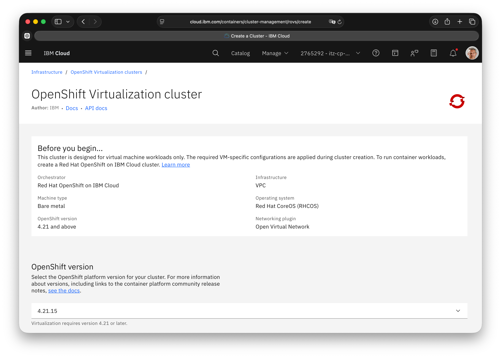

# ROVS Tutorials

*Red Hat OpenShift Virtualization Service on IBM Cloud*

---

Red Hat OpenShift Virtualization Service (ROVS) on IBM Cloud enables organizations to run virtual machines and containers on a single, unified platform. These tutorials provide step-by-step guidance to help you deploy, migrate, and network virtual workloads while leveraging the scalability, security, and operational consistency of OpenShift.

> In order to run these tutorials, you need to be invited to a ROVS cluster or provision one using the provided Terraform scripts. Provisioning this infrastructure may incur cost.

---

## Tutorials

| # | Tutorial | Description |
| :--- | :--- | :--- |
| **[1](./vm-management)** | **VM Management** | Create VMs, manage power states, and perform live migration between physical hosts. |
| **[2](./storage-management)** | **Storage Management** | Work with persistent storage, snapshots, restores, and VM cloning. |
| **[3](./template-instancetype)** | **Templates & InstanceTypes** | Customize VM templates, automate OS deployments, and use InstanceTypes for reusable compute configurations. |
| **[4](./networking)** | **Networking** | Configure VNIs, Localnet, NADs, and UDNs to connect VMs directly to IBM Cloud VPC subnets. |
| **[5](./vm-yaml)** | **VMs with YAML** | Deploy and manage virtual machines using YAML manifests, `oc`, and `virtctl`. |

---

## Prerequisites

Before starting the tutorials, ensure you have:

- An invitation to the ROVS shared cluster or your own provisioned cluster
- Your IBM Cloud credentials (SSO using your IBM ID: `name@xx.ibm.com`)
- Access to the shared ITZ account **"2765292 - itz-cp-emea"**
- The following CLI tools installed for Tutorial 5:
  - `oc` (OpenShift CLI)
  - `virtctl` (KubeVirt CLI)
  - `docker` or `podman`

For CLI setup instructions, see the [Connect to Cluster](./00-connect-to-cluster.md) guide.
